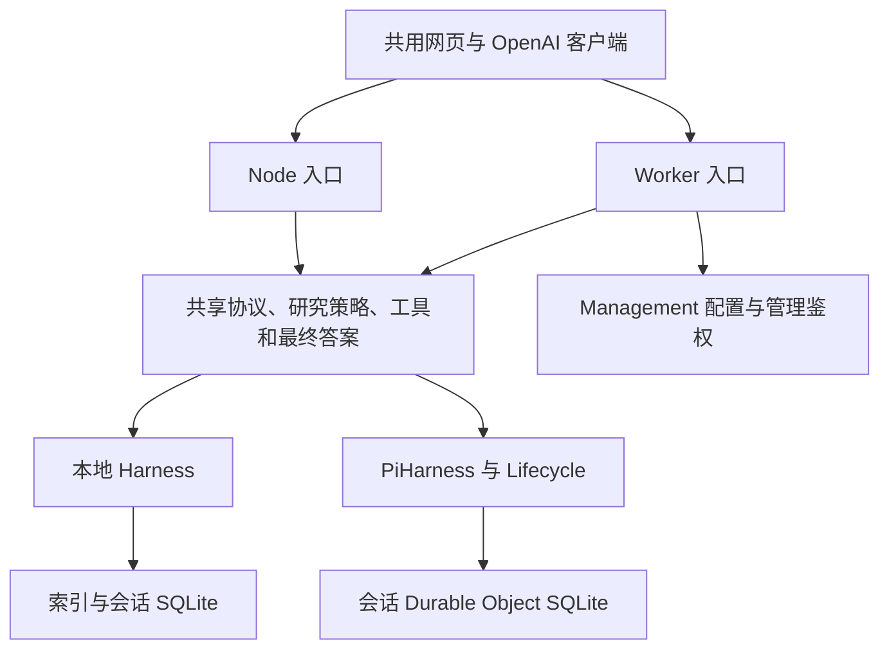

# 双部署架构与持久化边界

整合基线：main `374444e`、Cloudflare `0573e12`。两个分支无共同祖先，Worker 按模块引入 main，原分支保留历史。Pi 1.5.0 和 Agents 0.33.0 均未升级。

`packages/core` 共享校验、请求身份、历史规则、最终答案、错误、usage 和 Durable 注册；`packages/tools` 共享 HTTP 工具及缓存协议；`packages/ui` 是同一份无构建页面。本地为 ESM，Worker 为 TypeScript，共享模块只依赖标准 Web API。

`packages/core/types.d.ts` 记录任务和运行时合同，两端执行同一份公开 API 合同测试。HTTP、事务和生命周期各自实现。Node 同步 SHA-256 与 Worker 异步 Web Crypto 使用相同规范输入，不在 Node 同步事务中等待异步哈希。

## 本地

保留数据目录、索引 schema、会话 SHA-256 文件名、`pi_` 表前缀和 `picall.session/run/web` 文档标识。索引受理记录、固定 requestId 和幂等最终化继续关闭跨数据库崩溃窗口。SDK 管理模型和工具循环，主机管理单写者锁、执行容量、句柄释放及启动扫描。

## Cloudflare

保留 root conversation 1、PiHarness 的 `pi_` 前缀和原生模型引用。RequestKey 仍按 `SHA256(JSON.stringify(key))` 寻址，新任务的规范指纹不包含 stream 偏好。旧任务和历史按原算法验证，已完成查询不要求当前模型仍可调用。

新任务增加配置指纹和持久取消意图；没有配置指纹的旧在途任务保留记录并明确失败。PiHarness 工厂在自动 resume 前检查取消、过期、配置不匹配和旧在途状态。已提交的有效最终答案可在期限后最终化，模型及工具执行前仍有检查。

工厂始终传递 onWake；清理与监督使用 Lifecycle jobs，不覆盖其 alarm，也不使用 waitUntil 维持研究执行。Management 协调配置、登录及管理元数据，模型和工具仍在会话 DO 执行。管理日志页轮询元数据，旧任务只在按已知 ID 访问时加入索引，不枚举整个命名空间。

公共模型名与 SDK provider 引用分离。兼容网关使用共同 OpenAI 适配器；AI Gateway 保留 AI binding、BYOK alias 和 DeepSeek 原生协议。适配层关闭叠加重试，持久化前清理上游任意错误正文和响应头。

## 回放与保留

搜索结果、正文、缓存和调用数按 run 隔离。内存只合并当前进程请求，已提交工具结果复用，中断中的外部请求可能重放并重复计费。

任务结果和幂等记录保留 7 天；会话按 7 天不活跃清理。仍活跃的会话可以清理旧 API 结果和工具缓存，完整对话仍由 Pi 保存至整个会话过期。代码整合不合并两端数据。
